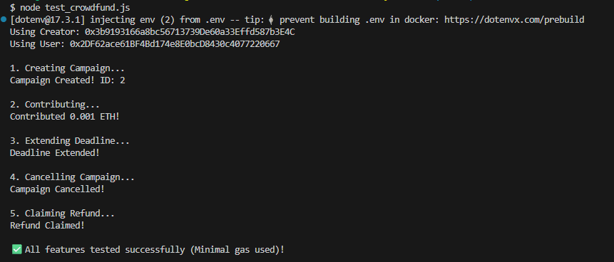
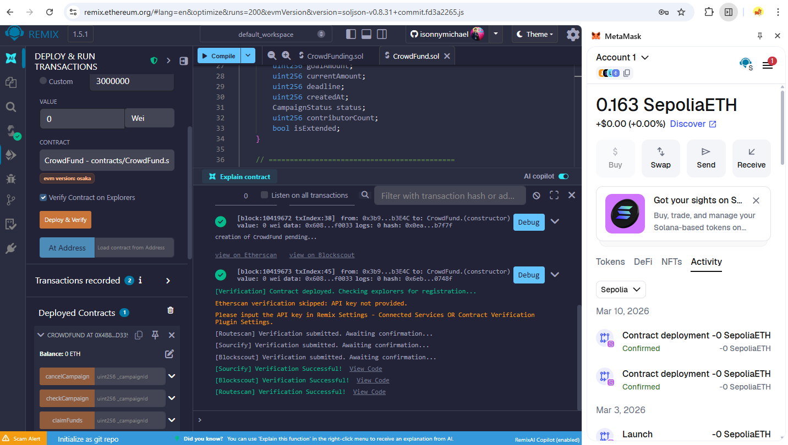
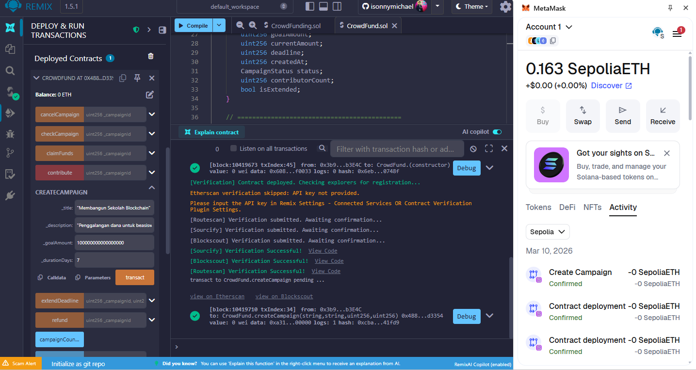
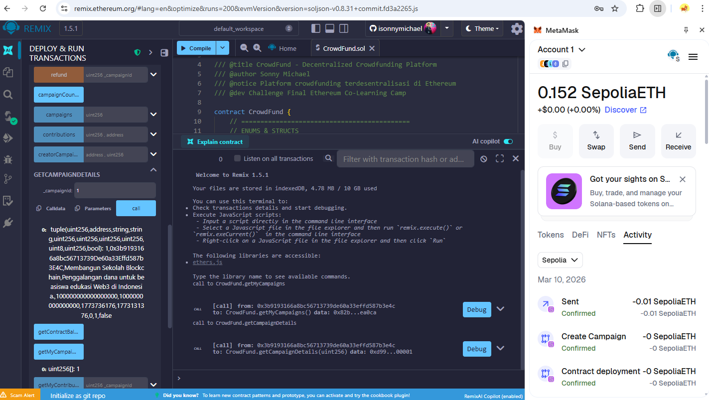
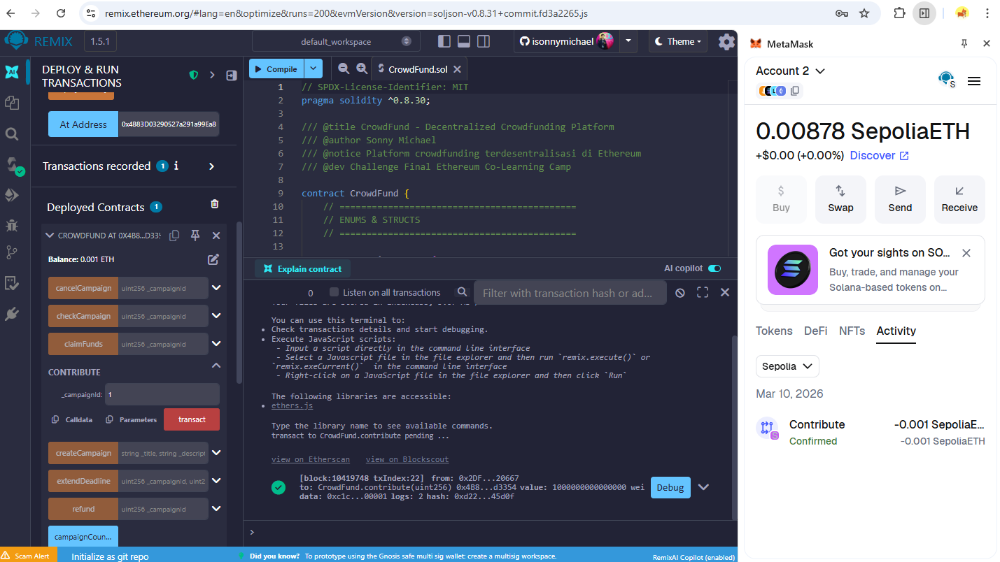
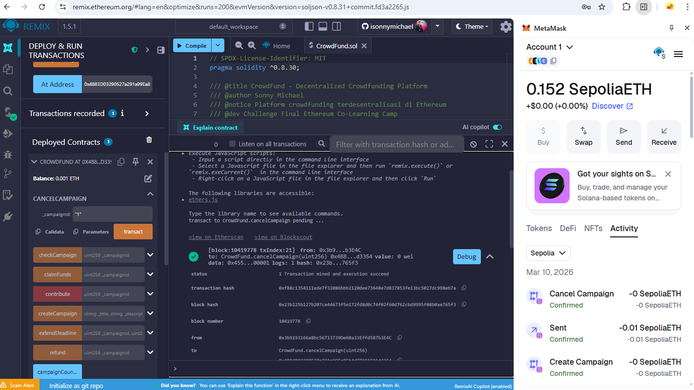

# CrowdFund - Ethereum Co-Learning Camp Challenge

## Author
- **Nama**: Sonny Michael
- **GitHub**: [isonnymichael](https://github.com/isonnymichael)
- **Wallet**: `0x2B36425Aa21B034045876853DaA93f82f1357116`

## Contract Address (Sepolia)
`0x4B83D03290527a291a99Ea85b4d772C1F91d3354`

## Features Implemented
- [x] **Membuat Campaign**: Creator bisa membuat penggalangan dana dengan target dan deadline.
- [x] **Kontribusi ETH**: Siapa pun bisa mendukung campaign dengan mengirimkan ETH.
- [x] **Claim Dana**: Creator bisa mencairkan dana jika target tercapai sebelum deadline.
- [x] **Refund Otomatis**: Kontributor bisa mengambil kembali ETH mereka jika campaign gagal atau dibatalkan.
- [x] **Cek Status**: Pembaruan status otomatis (Active, Successful, Failed, Claimed, Cancelled).
- [x] **Bonus: Pembatalan Campaign**: Creator dapat membatalkan campaign yang sedang aktif.
- [x] **Bonus: Perpanjangan Deadline**: Creator dapat memperpanjang deadline sekali (maksimal 7 hari).
- [x] **Bonus: Early Bird Tracking**: Melacak kontributor yang memberikan dukungan dalam 24 jam pertama.
- [x] **Keamanan (CEI)**: Menggunakan pola Checks-Effects-Interactions untuk mencegah serangan reentrancy.

## Automated Testing
Proyek ini dilengkapi dengan skrip pengujian otomatis menggunakan `ethers.js` untuk memverifikasi semua fitur secara langsung di jaringan Sepolia dengan penggunaan gas minimal.

### Cara Menjalankan Test
1. Pastikan dependensi terinstall: `npm install`
2. Konfigurasi `.env` dengan `PRIVATE_KEY_CREATOR` dan `PRIVATE_KEY_USER`.
3. Jalankan perintah:
   ```bash
   node test_crowdfund.js
   ```

## Screenshots
Berikut adalah beberapa bukti pengujian dan fungsionalitas kontrak:

### 1. Automated Test Result


### 2. Deployment


### 3. Campaign Detail & Creation



### 4. Contribution & Cancellation



## How to Test (Manual)
1. **Deploy**: Deploy kontrak di jaringan Sepolia melalui Remix.
2. **Buat Campaign**: Panggil fungsi `createCampaign` dengan parameter yang sesuai (lihat `MANUAL_TEST.md`).
3. **Kontribusi**: Gunakan akun berbeda untuk memanggil `contribute()`.
4. **Cek Milestone**:
    - Jika target tercapai: Creator memanggil `claimFunds()`.
    - Jika ingin membatalkan: Creator memanggil `cancelCampaign()`.
    - Lihat panduan lengkap di [MANUAL_TEST.md](MANUAL_TEST.md).

## Lessons Learned
Melalui tantangan ini, saya belajar tentang dasar-dasar pengembangan smart contract di EVM, termasuk penggunaan state variables, struktur data (struct & mapping), implementasi modifier untuk akses kontrol, serta alur kerja pengembangan menggunakan Remix IDE.